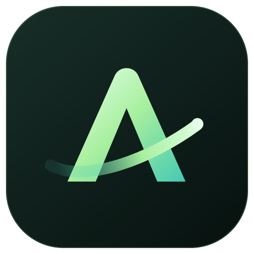
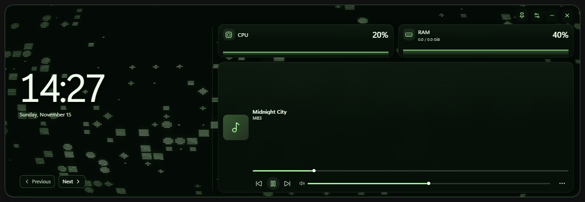
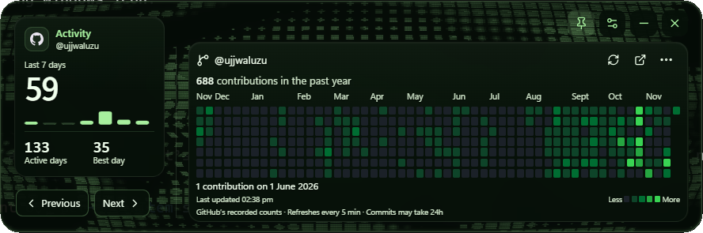
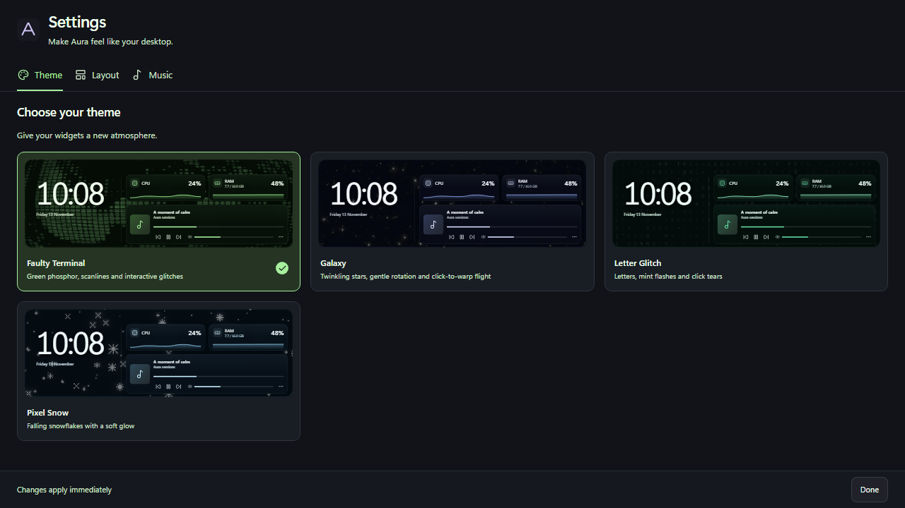

<div align="center">
  
  <h1 align="center">Aura</h1>
  <p align="center">
    A considered space for your desktop widgets.
    <br />
    A customizable Windows desktop companion for time, system activity, GitHub, and music.
  </p>
  <p align="center">
    <a href="https://github.com/ujjwaluzu/aura/actions/workflows/windows.yml"></a>
    
    
  </p>
</div>

<p align="center">
  
</p>

Aura is a native Windows desktop application built with **Tauri 2, Rust, React, and TypeScript**. Its small, frameless widget host sits over the desktop, while a separate settings window lets you choose a visual theme and widget layout.

> **Release status:** Aura is in Windows release-candidate testing. The public installer has not been published yet. The current candidate is unsigned, and YouTube account features remain gated while release requirements are finalized.

## What Aura does

- **Clock and system monitor**: local time and date, plus CPU and physical memory readings with short history sparklines.
- **GitHub Activity**: a contribution calendar, recent contribution summary, and active day statistics.
- **GitHub Work**: review requests, your pull requests, pull requests with failing checks, and assigned issues.
- **Music controls**: select a supported Windows browser media session and control playback. Aura Music also provides an account and library window for YouTube Music.
- **Four animated themes**: Faulty Terminal, Galaxy, Letter Glitch, and Pixel Snow.
- **Six widget layouts**: place the clock on either side and arrange the system monitor and music panel to suit your desktop.
- **Separate settings window**: theme and layout previews in an opaque, resizable window.

Theme and layout choices persist across restarts. The host is a 760 × 264 logical-pixel window; its native background is transparent so the desktop shows through around the glass panel.

## Screenshots

<p align="center">
  
  <br />
  <em>Your GitHub activity, directly on the desktop.</em>
</p>

<p align="center">
  
  <br />
  <em>Choose a theme and preview how it looks across the widgets.</em>
</p>

Screenshots captured from the running Windows app, including the actual widget, GitHub Activity, and native Settings window.

## Windows release

The latest source verification is available in [GitHub Actions](https://github.com/ujjwaluzu/aura/actions/workflows/windows.yml). A release page will be linked here once a Windows installer is ready for public distribution.

The candidate is not a signed public release. Windows may display an unknown-publisher or SmartScreen warning for unsigned installers. Clean-machine install, upgrade, and uninstall acceptance is still required before calling the installer ready for general use. See the [release notes and verification record](docs/releases.md).

## Run from source

Aura's native app builds on Windows. The frontend-only Vite preview is useful for UI work, but it does not provide native controls, Windows transparency, or system integrations.

### Requirements

- Windows 10 or 11, x64.
- [Node.js](https://nodejs.org/) 22.18 or later and pnpm 11.15.1.
- [Rust](https://rustup.rs/) 1.99 or later with the `x86_64-pc-windows-msvc` toolchain.
- [Microsoft C++ Build Tools](https://visualstudio.microsoft.com/visual-cpp-build-tools/) with **Desktop development with C++** and a Windows SDK.
- [Microsoft Edge WebView2 Runtime](https://developer.microsoft.com/en-us/microsoft-edge/webview2/).

### Start the desktop app

```powershell
git clone https://github.com/ujjwaluzu/aura.git
cd aura
pnpm.cmd install --frozen-lockfile
pnpm.cmd desktop:dev
```

Use `pnpm.cmd dev` to run the frontend preview at `http://127.0.0.1:1420/`. Open `http://127.0.0.1:1420/?window=settings` to inspect the settings view. The preview clearly reports that native services are unavailable and does not fabricate working native controls.

### Build a Windows installer

```powershell
pnpm.cmd desktop:build
```

The Tauri build creates a per-user NSIS installer under `src-tauri/target/release/bundle/nsis/`. The installed app uses WebView2 and requests its bootstrapper only when the runtime is not already available.

Aura enables startup for the current Windows user on its first release launch.
Use **Settings → General → Start Aura with Windows** to turn this off. The widget
opens visibly at sign-in with your saved theme and layout. Windows Startup apps
can override this registration. Development and isolated tests leave startup
settings untouched. See [Windows startup](docs/windows-startup.md).

## Development checks

Run the complete local verification suite with `cargo-audit` 0.23.0 installed:

```powershell
cargo install cargo-audit --version 0.23.0 --locked
pnpm.cmd install --frozen-lockfile
pnpm.cmd exec playwright install chromium
pnpm.cmd verify
```

`pnpm.cmd verify` runs formatting, linting, TypeScript and production builds, Rust formatting and Clippy, Rust unit tests, dependency audits, and the Chromium browser suite. GitHub Actions runs this verification on pushes and pull requests.

To build and smoke-test a release candidate on Windows:

```powershell
pnpm.cmd release:candidate
```

The installer, executable, dependency notices, check records, source fingerprint, toolchain record, and SHA-256 sums are written to `artifacts/release-candidate/`. Candidate smoke testing uses a separate temporary Aura and WebView2 profile. See [Windows release instructions](docs/releases.md) and [the verification guide](docs/verification.md).

## Architecture

```text
React + TypeScript + Vite
        │ typed, scoped Tauri commands/events
        ▼
Tauri 2 desktop shell ── WebView2 widget and settings windows
        │
        ▼
Rust services ── Windows system metrics, secure preferences,
                  GitHub integration, browser media sessions,
                  and YouTube Music API access
```

The frontend is packaged as local static assets; Aura does not require a hosted frontend or application server. Native operating-system access stays in Rust behind typed commands, validation, and per-window Tauri capabilities.

### Repository map

| Path                        | Purpose                                                        |
| --------------------------- | -------------------------------------------------------------- |
| `src/app/`                  | Window entry points and widget host composition                |
| `src/components/`           | Shared UI, settings screens, widgets, and animated backgrounds |
| `src/features/`             | Theme and layout catalogs, widget contracts, and integrations  |
| `src/hooks/`                | Native connection, preferences, and UI lifecycle               |
| `src/lib/` and `src/types/` | Typed frontend/native boundary and IPC models                  |
| `src-tauri/src/commands/`   | Narrow commands exposed to the frontend                        |
| `src-tauri/src/services/`   | Windows and provider business logic                            |
| `src-tauri/capabilities/`   | Per-window permissions                                         |
| `tests/`                    | Browser suite and opt-in native WebView smoke test             |
| `docs/`                     | Setup, architecture, integrations, and release procedures      |

## Privacy and integration notes

- The clock and system monitor run locally. Aura has no hosted backend or telemetry service.
- GitHub credentials and cached account data are protected with Windows DPAPI. Activity and Work refresh independently every five minutes.
- Aura's GitHub authorization requests `read:user` and `repo`. GitHub's `repo` scope includes write access, but Aura only sends read queries; it does not merge pull requests, submit reviews, edit issues, or rerun workflows.
- YouTube account features are gated in public builds while Google API distribution requirements are finalized. Browser media-session controls are a separate integration.
- Supported integrations need an internet connection. The core clock and system monitoring do not.

Read the [GitHub integration guide](docs/github.md), [YouTube Music notes](docs/youtube-music.md), and [native integration research](docs/native-integrations.md) for details.

## Current scope

Aura is an actively developed foundation. Per-widget drag and resize, notes, multiple named layouts, native wallpaper blur, and desktop-icon-layer integration are not implemented. Aura is a transparent top-level widget window, not a window embedded behind desktop icons.

## License

This repository does not currently include a license. Public visibility does not grant permission to reuse or redistribute the code; contact the project owner for licensing information.
